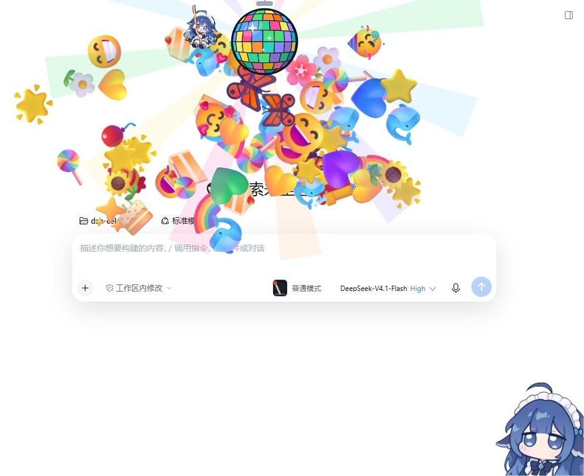
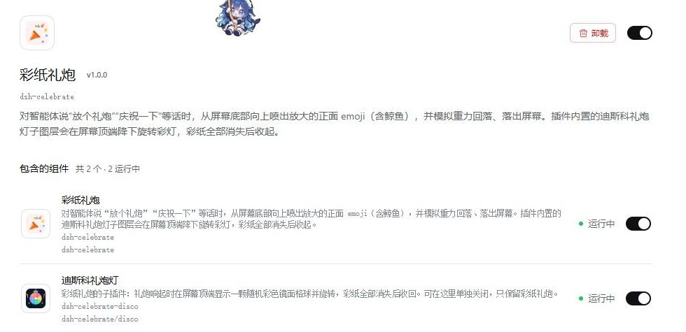

# dsh-celebrate

Agent-triggered **celebration confetti cannon** for the DeepSeek Harness Web UI.

When the agent calls the `celebrate` tool (for example because you said
“放个礼炮” or “庆祝一下”), the Web page launches enlarged emoji from the bottom
edge of the screen, lets them shoot up high, then fall back under gravity and
drop out of the bottom of the screen again — nothing sticks to the bottom edge.
The bundle's **built-in disco sub-layer** drops a spinning mirror-tile disco ball
in at the top of the screen for the same moment and retracts it once the last
emoji has disappeared.

The disco lamp is the bundle's **sub-plugin component**: a second Loader row
whose localized name and description come from `disco/locale/*.json`. The lamp
layer itself is rendered by the parent client, but it only appears while that
component is active: the component owns a small availability route, and the
client checks it before every burst. Installing this bundle deploys both
components; the Plugin Manager's bundle detail page lists them separately, so
the confetti cannon and the lamp can be switched on or off independently.

## Screenshots

A burst: 60 enlarged emoji shoot up from the bottom edge while the lamp spins at
the top of the screen.



The bundle detail page lists both components with their own name, description,
icon and switch:



## When it fires

The tool description asks the agent to call it for phrases such as:

- 放个礼炮 / 放礼花 / 来点彩纸 / 撒花
- 庆祝一下 / 庆祝成功 / 恭喜恭喜 / 开香槟
- celebrate / congrats / party / confetti

It is explicitly told **not** to fire for bad news, failures, grief, or routine
successes the user did not ask to celebrate.

## Emoji policy

Only positive, festive emoji are used — never sad, angry, hurt or otherwise
negative ones — and both whales are always part of every burst:
`🐋` (first particle) and `🐳` (second particle). The rest are drawn from a
positive palette: 🎉 🎊 🎈 🎁 ✨ 🌟 ⭐ 🥳 😄 😁 🤩 🥰 💖 💛 💚 💙 💜 🌈 🍰 🎂 🍭
🍬 🌸 🌼 🌻 🦋 ☀️.

Each burst uses **60 emoji**, at roughly **54–108 px** (double the original
size), scaled to the viewport height. A second burst while the first is still in
flight adds a new wave (hard cap 280 live particles).

## Install

The bundle is a plain, dependency-free package; the repository root *is* the
package (no build step, no runtime dependencies).

```powershell
git clone https://github.com/qwunros/dsh-celebrate
dsh plugin --profile web add link:<path-to-the-clone>
```

In the Web UI you can also use **插件 → 添加插件 → 本地目录** and pick the
cloned directory.

Enabling it registers the tool, the confetti component and the disco component
together. There is no second package to install.

### Separate switches

The bundle contains two Loader components:

- `dsh-celebrate` — the `celebrate` tool, the confetti layer and the lamp layer;
- `dsh-celebrate-disco` — the lamp sub-plugin component (nested package under
  `disco/`, host-only availability route).

Open **插件 → 已安装插件 → 彩纸礼炮 → 包含的组件**; each component has its own
name, description, icon and switch. Turning the disco component off leaves the
confetti cannon fully working (and vice versa). Disabling the whole bundle
disables both.

## How it works

```text
user: “放个礼炮”
  → agent calls tool `celebrate`              (Host half, index.js)
  → Host broadcasts an SSE frame               GET /dsh-celebrate/events
  → confetti client receives `celebrate`       (dsh-celebrate, shell.overlay)
  → confetti layer spawns emoji and dispatches `dsh-celebrate:burst`
  → client asks GET /dsh-celebrate/disco       (owned by the disco component)
  → only if that route answers JSON, the lamp shows
  → the last confetti emoji leaves the screen
  → confetti layer dispatches `dsh-celebrate:settled`
  → disco lamp retracts with an ease-in transition
```

The browser routes are document-relative (`dsh-celebrate/events`,
`dsh-celebrate/disco`) the same way the shipped HMR channel addresses
`plugins/events`, so they also work when the page is mounted under a directory.
The SSE stream is read through `globalThis.__DSH_TRANSPORT__.fetch` when the
shell provides one, otherwise through the browser's `EventSource`.

### Component contract (inside this bundle)

The two components are separate Loader rows; the lamp's rendering lives in the
parent client and is gated by the sub-plugin's availability route, so either
component can be switched off without touching the other:

| Component | Loader form | Overlay entry | Role |
| --- | --- | --- | --- |
| `dsh-celebrate` | package root (`index.js`/`client.js`) | `dsh-celebrate.confetti` (order 20), `dsh-celebrate.disco` (order 10) | Confetti emoji, plus the lamp layer it gates at runtime |
| `dsh-celebrate-disco` | host-only subpath (`dsh-celebrate/disco`) | — | Owns `GET /dsh-celebrate/disco`; its presence is the lamp switch |

The parent client swaps between the two `window` events:

| Event | Payload | Meaning |
| --- | --- | --- |
| `dsh-celebrate:burst` | `detail.seq`, `detail.count` | A new burst started; check the disco route and show the lamp if enabled. |
| `dsh-celebrate:settled` | none | Every emoji of the pool has disappeared; retract the lamp. |

That makes the lamp follow the actual animation instead of a guessed timer. The
lamp also has a 12 s safety timeout in case the confetti layer is torn down
mid-animation.

## Disco sub-plugin

- The component row is host-only and carries its own localized name,
  description and icon (`disco/locale/*.json`, `disco/icon.svg`). The bundle
  export map re-exports them as `./disco/locale/*.json` and `./disco/icon` so
  the Plugin Manager can read them for the subpath row.
- A canvas-rendered **mirror-tile ball** (120 px): a UV sphere of quads, each tile
  with its own random colour from a 16-colour palette, dark grout and a crisp dark
  rim.
- Real **3D rotation** in a level (eye-level) view: no tilt, the sphere spins
  around Y; quads are projected with perspective, foreshortened at the edges and
  painted back to front. Near tiles are larger, far tiles smaller.
- **3渲2 / cel-shaded**: lambert lighting from the upper-left is quantized into
  three flat bands plus flat white glints — no cast shadow, smooth gradients or
  photoreal reflections.
- Twelve translucent rays fan out behind the ball and rotate once every 22 s; the
  ball makes one turn every 7.2 s.
- It hangs at the very top edge, strictly centred horizontally.
- It drops in from above the viewport with `cubic-bezier(.22,1,.36,1)`
  (ease-out), and retracts with `cubic-bezier(.55,.06,.85,.35)` (ease-in).

## Tunables

Values live in the source because the bundle intentionally has no package
dependencies (no Schemastery/Config):

- `DEFAULT_EMOJI_COUNT` (`60`) and `MAX_EMOJI` (`280`) in `index.js` /
  `client.js`;
- the launch apex, apex time, gravity and the 2× emoji size in
  `client.js → makeParticle`;
- the disco palette, tile grid and spin durations in `client.js → BALL_*` /
  `DISCO_*`.

## Files

| File | Role |
| --- | --- |
| `index.js` | Host half: `celebrate` tool + `/dsh-celebrate/events` SSE route |
| `client.js` | Confetti physics and the gated disco layer |
| `disco/index.js` | Host-only sub-plugin component: `GET /dsh-celebrate/disco` availability route |
| `disco/locale/*.json`, `disco/icon.svg` | Component name, description and icon |
| `cordis.patch.yml` | Two Loader rows for the bundle |
| `locale/en.json`, `locale/zh.json` | Bundle title/description |
| `icon.svg` | Original flat party-popper icon |
| `docs/*.jpg` | README screenshots (cropped to the app area) |

## License

MIT — see [LICENSE](LICENSE).

Chinese README: [README.md](README.md).
