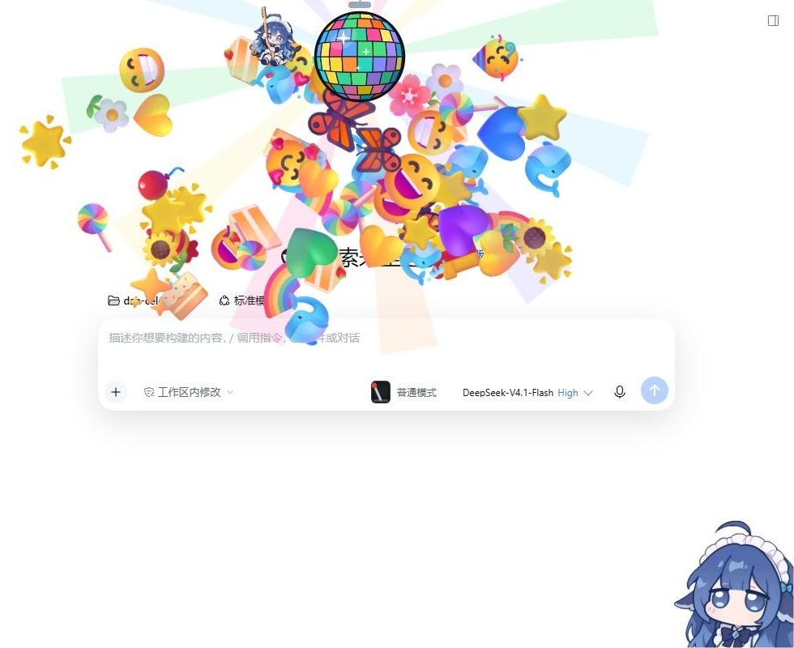

# 彩纸礼炮 · dsh-celebrate

面向 DeepSeek Harness Web UI 的「彩纸礼炮」插件。启用后，让智能体放个礼炮（例如对它说
“放个礼炮”“庆祝一下”），屏幕底部会向上喷出放大的正面 emoji，划出高高的抛物线后
直接落出屏幕外；同时，bundle 内置的迪斯科灯子图层会在屏幕顶端降下一颗
随机彩色镜面格球：它真实地 3D 旋转，采用 3渲2 分层着色，并带有放射光线；等最后一颗
彩纸 emoji 消失后再缓入式收回。

迪斯科礼炮灯是**本 bundle 内的子插件组件**，不是需要单独安装的插件：同一个包里包含
两个组件行，安装本 bundle 即得到全部能力；在
「插件 → 已安装插件 → 彩纸礼炮 → 包含的组件」里可以分别开关彩纸礼炮和迪斯科灯。



## 安装

仓库根目录就是一个零依赖、免构建的插件包：

```bash
git clone https://github.com/qwunros/dsh-celebrate
dsh plugin --profile web add link:<克隆目录的路径>
```

也可以在 DSH 的「插件 → 添加插件 → 本地目录」中选择克隆下来的目录。
安装后默认启用两个组件，无需再安装第二个包。

## 分别开关

打开 **插件 → 已安装插件 → 彩纸礼炮 → 包含的组件**，会看到两行，各带一个开关：

- **彩纸礼炮**（`dsh-celebrate`）：工具、彩纸层，以及受开关控制的灯图层；
- **迪斯科礼炮灯**（`dsh-celebrate-disco`）：灯子组件，自带名称、描述、图标和独立开关。


关掉灯组件后，放礼炮仍然只有彩纸；关掉主组件后灯不会亮，但两个组件仍随 bundle 一起安装。
整个 bundle 的总开关会同时关掉两者。

## 功能

- **触发**：向所有智能体注册 `celebrate` 工具，工具描述明确要求“放个礼炮”
  “庆祝一下”“恭喜”“撒花”“celebrate”“congrats”等表述时调用，并要求不要用于坏消息、
  失败或悲伤场景。
- **彩纸**：每次 60 颗 emoji（可调），尺寸约为原来的 2 倍（约 54–108px）；从屏幕底端
  以高抛物线向上喷出，重力回落，完全越过底边后移除，不会卡在屏幕底部。emoji 只用
  正面、喜庆的图案，并保证每次都包含 🐋 和 🐳 两颗鲸鱼。
- **迪斯科灯（bundle 内置子插件）**：屏幕顶端降下一颗随机彩色镜面格球，采用 canvas
  透视投影做出真实 3D 旋转；每格颜色随机，光照量化为三档平涂色块（3渲2），配白色
  高光和 12 道旋转光线；降下用 ease-out，收回用 ease-in。彩纸图层在最后
  一颗 emoji 消失时派发 `dsh-celebrate:settled`，灯随即收回；灯另有 12 秒安全超时。
- **风格**：灯球是平视视角的 3D 格球（不倾斜、无投影阴影）+ 3渲2 平涂分色、深色
  勾边与高光；光线为半透明硬边三角形，整体仍是干净的平面化插画感。

## 结构

```text
index.js            Host：celebrate 工具 + GET /dsh-celebrate/events (SSE)
client.js           彩纸物理 + 受开关控制的迪斯科灯图层
disco/              迪斯科灯子组件（host-only 子路径行）
  index.js          Host：GET /dsh-celebrate/disco 可用性路由（行存在即灯开启）
  locale/{en,zh}.json 组件名称与描述
  icon.svg          组件图标
cordis.patch.yml    两个组件行的 Loader 声明
locale/{en,zh}.json bundle 显示文本
icon.svg            原创扁平礼炮图标
```

包零运行时依赖（只使用页面自带的 React 与 DSH 服务），以本地目录 `link:` 安装即可，
不需要构建步骤。

## 两个组件与图层

| 组件 | 图层 id（order） | 作用 |
| --- | --- | --- |
| `dsh-celebrate` | `dsh-celebrate.confetti` (20) + `dsh-celebrate.disco` (10) | 彩纸 emoji；灯图层由父客户端渲染并受子组件开关控制 |
| `dsh-celebrate-disco` | —（host-only） | 注册 `GET /dsh-celebrate/disco`；有这条路由才亮灯 |

两个组件通过「可用性路由 + `window` 事件」联动：`dsh-celebrate:burst` 时父客户端先询问
`/dsh-celebrate/disco`，仅当子组件启用（路由返回 JSON）才显示灯；`dsh-celebrate:settled`
收灯。因此灯跟随实际动画结束，而不是靠猜时间。

## 说明

- 需要 Web GUI（`/dsh-celebrate/events` 由 `webServer` 提供）；没有 Web 端的 profile
  里工具仍然存在，只是没有可以播放动画的页面。
- 修改 `client.js` 后，DSH 的客户端 HMR 会在约 0.5 秒内把新 bundle 推给已打开的页面；
  如果页面没有更新，刷新一次即可。
- 卸载：`dsh plugin --profile web remove dsh-celebrate`。

## License

MIT，见 [LICENSE](LICENSE)。English README: [README.md](README.md)。